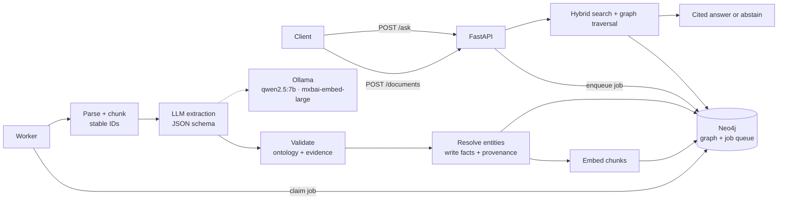

# AI Knowledge Graph Builder

Turn documents into a **traceable knowledge graph** and ask questions that are answered **only from evidence**, with citations, or not at all.

Upload a PDF or text file. A local LLM extracts people, companies, projects and technologies. Code validates every proposed fact against the source text. The facts that pass are stored in Neo4j together with the exact quote, chunk and page they came from. Questions are answered by combining graph traversal with vector and keyword search (GraphRAG).

Everything runs locally: **Neo4j + Ollama + Python**, with no paid API keys.

> **Design principle:** the LLM *proposes* facts → application code *validates* them → Neo4j *stores* them.
> Model-generated Cypher is never executed.

---

## Highlights

- **Evidence-first extraction.** Every relationship must carry a quote that really appears in the chunk *and* names both entities. Unsupported facts go to a human review queue instead of the graph.
- **Provenance on every fact.** "Why does the graph say X?" returns the document, page, chunk and quote. Deleting a document removes only the facts that no other document supports.
- **Idempotent by design.** Content-hash document IDs, deterministic chunk/entity/relation IDs and `MERGE` everywhere mean that uploading or reprocessing the same file never creates duplicates.
- **Entity resolution.** "Tech Nova" resolves to the existing `TechNova` and is recorded as an alias. Ambiguous matches are flagged for review, never guessed.
- **Hybrid GraphRAG with abstention.** Keyword + vector search (rank fusion) plus 1–2 hop graph traversal. Answers must cite real sources, and off-topic or unsupported questions get *"The knowledge base does not contain enough information."*
- **Production-minded.** Async job queue with retries/backoff and crash recovery, an API-key-protected FastAPI service, JSON logs with trace IDs, metrics, rate limits, Docker health checks, backups with an automatic restore test, and a regression gate.

---

## Architecture



**Graph model**

```
(:Document)-[:HAS_CHUNK]->(:Chunk {text, page, embedding})-[:MENTIONS]->(:Entity:Person|Company|Project|Technology|Team)
(:Entity)-[:WORKS_AT {role, evidence[], sourceChunkIds[], sourceDocIds[], model, promptVersion}]->(:Entity)
(:ReviewItem {status, reason, payload})-[:FROM_CHUNK]->(:Chunk)
```

---

## Results

Measured on this project's sample data with `qwen2.5:7b` and `mxbai-embed-large` on an 8 GB Apple M2.

**Retrieval:** 15 paraphrased questions, top 5 results

| Method | Recall@5 | MRR |
|---|---|---|
| Keyword (full-text) | 0.93 | 0.68 |
| Vector | 0.93 | 0.72 |
| **Hybrid (rank fusion)** | **1.00** | **0.87** |

**Question answering:** behaviour on six test questions

| Question type | Behaviour |
|---|---|
| Two-hop graph question ("Harshit's project and who else works on it") | ✅ answered, citing graph facts |
| Answer only in a passage | ✅ answered, citing the page |
| Off-topic ("capital of France") | ✅ abstains *without* calling the LLM |
| On-topic but unknown ("TechNova's London office") | ✅ abstains |
| Prompt injection inside a document | ✅ treated as data, not instructions |
| Correct answer with a weak citation | ⚠️ flagged: "2019 not found in cited sources" |

**Extraction:** first run on the sample document: 12 accepted, 2 sent to review, 5 rejected. Both
review items were real model errors, for example a quote about one person attached to another.

**Processing time:** about 2 minutes per chunk-sized document. LLM extraction takes about 70% of it.

---

## Quick start

**Prerequisites:** Docker Desktop, [Ollama](https://ollama.com), Python 3.12.

```bash
git clone https://github.com/HARSHIT-3112/AI_KNOWLEDGE_GRAPH_BUILDER.git
cd AI_KNOWLEDGE_GRAPH_BUILDER

ollama pull qwen2.5:7b
ollama pull mxbai-embed-large

cp .env.example .env            # then set NEO4J_PASSWORD and API_KEY to long random values
docker compose up -d --build    # Neo4j + API + worker, with health checks
docker compose ps               # wait until all three are (healthy)
```

- API docs: <http://localhost:8000/docs>. Click **Authorize** and paste your `API_KEY`.
- Neo4j Browser: <http://localhost:7475>. Connect URL `bolt://localhost:7688`, user `neo4j`.

### Use it

```bash
KEY=$(grep '^API_KEY=' .env | cut -d= -f2)

# upload → returns a document id (same file again → duplicate: true)
curl -H "X-API-Key: $KEY" -F "file=@documents/sample_company.txt" localhost:8000/documents

# watch it move through chunking → extracting n/N → writing_graph → indexing → completed
curl -H "X-API-Key: $KEY" localhost:8000/documents/<document_id>

# ask
curl -H "X-API-Key: $KEY" -H "Content-Type: application/json" \
     -d '{"question": "Who works on VisionAI?"}' localhost:8000/ask
```

| Endpoint | Purpose |
|---|---|
| `POST /documents` | Upload PDF/TXT/MD (streamed, size-limited, validated) → 202 + job id |
| `GET /documents`, `GET /documents/{id}` | Status, stage, progress, attempts, errors, counts |
| `POST /documents/{id}/reprocess` · `DELETE /documents/{id}` | Re-run or delete (with its unsupported facts) |
| `POST /ask` | Cited GraphRAG answer, or abstention |
| `GET /search?q=&mode=hybrid\|vector\|keyword` | Retrieve passages |
| `GET /entities/{id}` | An entity's facts with supporting quotes |
| `GET /review` | Facts waiting for human review |
| `GET /metrics` · `/health/live` · `/health/ready` | Operations |

### Local development (without the API containers)

```bash
python -m venv .venv && source .venv/bin/activate
pip install -r requirements.txt
docker compose up -d neo4j

python -m scripts.m3_ingest_document documents/sample_company.txt   # parse + chunk
python -m scripts.m4_extract documents/sample_company.txt           # LLM extraction (no DB writes)
python -m scripts.m5_write_graph documents/sample_company.txt       # validate + write graph
python -m scripts.m7_embed                                          # embeddings
python -m scripts.m8_ask "Which project does Harshit work on?"      # GraphRAG
bash scripts/check.sh                                               # tests + retrieval regression gate
```

---

## Project structure

```
app/
  core/         config (pydantic-settings), JSON logging with trace ids
  db/           Neo4j driver lifecycle
  ingestion/    file validation (SHA-256 ids), PDF/TXT parsing, paragraph-aware chunking
  schemas/      Pydantic extraction schema, generated from the ontology
  extraction/   versioned prompts, Ollama client (structured output, bounded retries), evidence validator
  graph/        ontology allow-lists, deterministic ids, repository, entity resolver, graph writer
  retrieval/    embeddings, vector/keyword/hybrid search, entity linking + traversal, cited answerer
  pipeline/     Neo4j-backed job queue (atomic claim, retry/backoff, stale recovery), worker
  api/          FastAPI app, API-key auth, rate limiting, metrics
scripts/        one script per milestone, worker, backup with restore test, quality gate
tests/          unit, Neo4j integration, LLM contract (faked model), API/worker, hardening
lessons/        Cypher exercises to run in Neo4j Browser
eval/           labelled retrieval questions
```

---

## Engineering decisions worth noting

| Decision | Why |
|---|---|
| Ontology allow-list feeds the schema, prompt and validator | One source of truth; labels and relationship types can't be parameterised in Cypher, so they're allow-listed instead |
| Evidence must exist in the chunk **and** name both endpoints | Real model failure: a genuine quote about one person attached to a different person |
| Citations are a *required* JSON-schema field | The model ignored "cite inline", then omitted an optional `citations` field. Only a required field was enforced |
| Two abstention layers | A similarity threshold catches off-topic questions cheaply, but on-topic unknowns score high, so a citation gate is needed too |
| Jobs stored in Neo4j, not Redis | No extra service on an 8 GB laptop and state survives restarts. Atomic claim uses the write-lock-then-recheck pattern |
| Named job queues | Real incident: a live worker claimed a job uploaded by the test suite |
| Liveness ≠ readiness | A database outage must not make Docker restart the API in a loop |
| Backups include an automatic restore test | The first attempt failed because Docker force-killed Neo4j before a clean shutdown. A backup is only trustworthy once it has been restored |

---

## Testing

```bash
bash scripts/check.sh
```

This runs 73 tests: unit tests, Neo4j integration (idempotency, rollback, constraints, provenance, deletion), LLM contract tests with a faked model, API and worker tests (auth, upload limits, duplicate uploads, retries, permanent failures, atomic claims), and hardening tests. It then runs a retrieval regression gate (hybrid Recall@5 ≥ 0.93, MRR ≥ 0.80).

Integration tests namespace their data and clean up after themselves, and they use a private job queue, so they're safe to run against a live system.

---

## Limitations

- A single polling worker. Scaling out would mean Redis + RQ/Celery and a GPU-backed or hosted LLM, which is the real bottleneck.
- One API key means full access. Per-user and per-document permissions are needed before multi-user use.
- No OCR for scanned PDFs, no alerting on `/metrics`, and rate limits are per process.
- The evaluation sets are small and hand-labelled: useful as regression checks, not benchmarks.

See **[RUNBOOK.md](RUNBOOK.md)** for operations (health, logs, troubleshooting, backup/restore) and **[LEARNING.md](LEARNING.md)** for the milestone-by-milestone build log, experiments and concept checkpoints.

---

## Tech stack

Python 3.12 · Neo4j 2026.10 (Cypher 25, vector + full-text indexes) · Ollama (qwen2.5:7b, mxbai-embed-large) · Pydantic · FastAPI · PyMuPDF · httpx · pytest · Docker Compose
